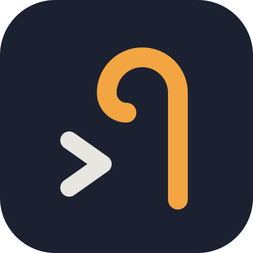

<p align="center"></p>
<h1 align="center">herdsman</h1>
<p align="center"><a href="https://github.com/remziduzagac/herdsman/actions/workflows/ci.yml"></a></p>

A terminal workspace for running coding agents: workspaces, tabs and panes, SSH-connected
machines, and agents recognised by state in the sidebar. On top of that, **stacked panes**:
one layout slot holds several panes and shows one at a time, while the hidden ones keep running.

![herdsman: a repository's worktrees in sections in the sidebar, and an editor beside a stack of agent panes][shot]

[shot]: docs/next/website/src/assets/screenshots/overview.webp

herdsman is built on [herdr](https://github.com/herdrdev/herdr): a modified version, renamed into
a separate app, that keeps taking in herdr's releases. It is not affiliated with or endorsed by
herdr. See [NOTICE](NOTICE).

## Status

Early. [CHANGELOG.md](CHANGELOG.md) lists each release and the herdr release it is built on.
Preview builds of upcoming changes are available to installs made with the install script, not
to Homebrew, mise, Nix or the package repositories: `herdsman channel set preview`.

## Install

```bash
curl -fsSL https://remziduzagac.github.io/herdsman/install.sh | sh    # Linux, macOS
brew install remziduzagac/tap/herdsman                                 # Homebrew
mise use -g github:remziduzagac/herdsman                               # mise
```

Signed apt, dnf and pacman repositories, Windows, Nix and manual downloads are covered in the
[install guide](https://remziduzagac.github.io/herdsman/docs/install/).

## How it differs from herdr

- **Its own app.** The binary, `~/.config/herdsman`, the socket, the `HERDSMAN_*` environment
  variables and the agent hooks all carry herdsman's name, so herdsman and herdr run side by side
  without sharing anything.
- **Stacked panes.** `prefix+alt+c`, or Stack here in a pane's right-click menu, puts a new pane
  behind the current one, and a strip along the slot switches between them.
  [The stacks page](https://remziduzagac.github.io/herdsman/docs/stacks/) has the keys, CLI and
  behaviour.
- **Equal pane sizes.** `prefix+|` gives every column in the tab the same width and `prefix+_`
  every row the same height. A pane's right-click menu and `herdsman tab equalize` do the same.
- **Worktree sections.** A repository's worktrees can be sorted into named sections, each under
  its own collapsible header in the sidebar, from a worktree's right-click menu or
  `herdsman workspace section`.
- **The agent skill comes with the integrations.** `herdsman integration install claude`, `codex`
  or `opencode` also installs herdsman's
  [agent skill](https://remziduzagac.github.io/herdsman/docs/agent-skill/), and `herdsman update`
  keeps it matched to the new binary.
- **Updates that respect your package manager.** `herdsman update` points apt, dnf and pacman
  installs at their package manager instead of replacing a file it owns.

## Building

```bash
cargo build --release --locked     # binary at target/release/herdsman
```

The vendored libghostty-vt needs Zig 0.16.0 on `PATH`. [CONTRIBUTING.md](CONTRIBUTING.md) lists
the rest of the tools and how to run the tests.

## Documentation

- [Documentation](https://remziduzagac.github.io/herdsman/docs/): install, configuration, keys, agents, the CLI and the socket
  API.
- `herdsman --help` for the CLI, and `herdsman --skill` for the agent skill.
- [MAINTAINING.md](MAINTAINING.md): branches, versions, and how herdr releases are merged in.
- [CONTRIBUTING.md](CONTRIBUTING.md): issues, pull requests, building and testing.

## Licence

Apache License 2.0, as herdr. See [LICENSE](LICENSE) and [NOTICE](NOTICE).
