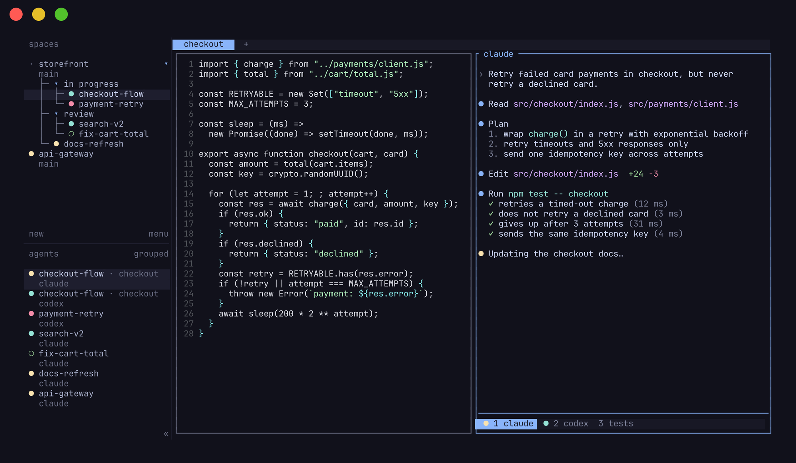

import { Card, CardGrid } from '@astrojs/starlight/components';



## Pick your path

<CardGrid>
  <Card title="New to terminal multiplexers?">
    You don't need to learn shortcuts to start. Herdsman is mouse-first: click panes, drag borders, split and switch from right-click menus.

    [Quick start →](/docs/quick-start/)
  </Card>
  <Card title="Coming from tmux or zellij?">
    You already know the model. The prefix is `ctrl+b`, panes persist, detach and reattach work the way you expect.

    [Concepts →](/docs/concepts/) · [Keybindings →](/docs/configuration/#keybindings)
  </Card>
</CardGrid>

## Or let your agent introduce you

If you already run an AI coding agent, let it handle the onboarding. Paste this prompt:

```text
Help me understand and set up Herdsman. Read https://remziduzagac.github.io/herdsman/agent-guide.md first, then walk me through it step by step.
```

The guide covers Herdsman's concepts, setup, configuration, and common fixes, so your agent can answer from the docs instead of improvising.

## Core guides

<CardGrid>
  <Card title="Agents">
    See supported agents, detection behavior, integrations, custom labels, and direct attach.

    [Understand agents →](/docs/agents/)
  </Card>
  <Card title="Connecting machines">
    Keep Local and saved SSH machines in one window, with a combined agent list and independent reconnects.

    [Connect your machines →](/docs/connecting-machines/)
  </Card>
  <Card title="Session state">
    Understand detach, restart restore, pane history replay, native agent resume, and live handoff.

    [Compare state paths →](/docs/session-state/)
  </Card>
  <Card title="Configuration">
    Configure keybindings, themes, sidebar behavior, notifications, scrollback, and advanced options.

    [Configure Herdsman →](/docs/configuration/)
  </Card>
  <Card title="API">
    Control Herdsman from scripts, tools, and agents through the CLI and local socket API.

    [Read the API guide →](/docs/socket-api/)
  </Card>
  <Card title="Plugins">
    Author local executable workflow plugins with manifest actions and event hooks.

    [Write a plugin →](/docs/plugins/)
  </Card>
  <Card title="Stacked panes">
    Keep several panes in one slot and show one at a time, while the hidden ones keep running.

    [Stacks →](/docs/stacks/)
  </Card>
  <Card title="What herdsman adds">
    Every feature herdsman has on top of herdr, with the release it arrived in.

    [What herdsman adds →](/docs/what-herdsman-adds/)
  </Card>
</CardGrid>
